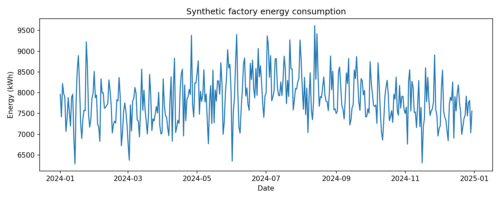

# Smart Factory Energy Optimisation Using Machine Learning

**Python · Pandas · Scikit-learn · K-Means · PCA · Energy Analytics**

A public demonstration inspired by my MSc Artificial Intelligence and Data Science research at the University of Hull. It uses synthetic factory data to explore relationships between operating conditions and electricity consumption.



## Business problem

Manufacturers need to understand how production, equipment loads and environmental conditions relate to electricity demand. Identifying operating patterns can help prioritise investigations into energy efficiency.

## Business solution

Developed a Python analysis workflow that checks data, compares energy-related variables and groups similar operating conditions using unsupervised learning. The public demonstration combines preprocessing, cluster evaluation and visualisation to support further investigation of factory operating modes.

## Research context

The original MSc research explored autoencoder-based clustering, PCA-based clustering, hierarchical clustering and time-series analysis. This public version provides a smaller **K-Means demonstration**, with **PCA used for two-dimensional visualisation**.

## Tools and approach

- **Pandas:** data preparation, summaries and correlations.
- **SimpleImputer and StandardScaler:** median imputation and feature scaling.
- **K-Means:** compare candidate cluster counts from two to five.
- **Silhouette score:** select a cluster count for the synthetic sample.
- **PCA and Matplotlib:** visualise operating groups and energy trends.

## Key findings from the public demonstration

1. **Production output and equipment-related energy use are positively associated with total electricity consumption** in the synthetic data.
2. **The current demonstration selects two operating groups** from the candidate cluster counts.
3. **The group with higher average cooling demand also has higher average total energy use**, providing a comparison to investigate further.

These observations describe the synthetic demonstration, not the original industrial research results or measured energy savings.

## Business recommendations

- Monitor energy intensity, such as electricity used per unit produced, alongside total consumption.
- Compare equipment loads across operating groups when prioritising efficiency investigations.
- Validate patterns using suitable production and equipment data before proposing operational changes.

## Run the demonstration

Download the repository and run these commands from its main folder:

```bash
python -m pip install -r requirements.txt
python src/analysis.py
```

The script prints data summaries, correlations and cluster profiles, and saves two charts in the repository's main folder.

## Explore the project

| File | Purpose |
| --- | --- |
| [src/analysis.py](src/analysis.py) | Runnable analysis and chart generation. |
| [notebooks/synthetic_energy_demo.ipynb](notebooks/synthetic_energy_demo.ipynb) | Notebook version of the demonstration. |
| [data/synthetic_factory_energy.csv](data/synthetic_factory_energy.csv) | Synthetic daily factory observations. |
| [synthetic_clusters.png](synthetic_clusters.png) | PCA view of the operating groups. |
| [requirements.txt](requirements.txt) | Python dependencies. |

## Data note

All public data and generated charts are synthetic. The original industrial datasets and confidential research materials are not included.

---

**Oluwatobiloba Olufowobi**  
[LinkedIn](https://www.linkedin.com/in/olufowobi365/) · [GitHub](https://github.com/OlufowobiJosh)
